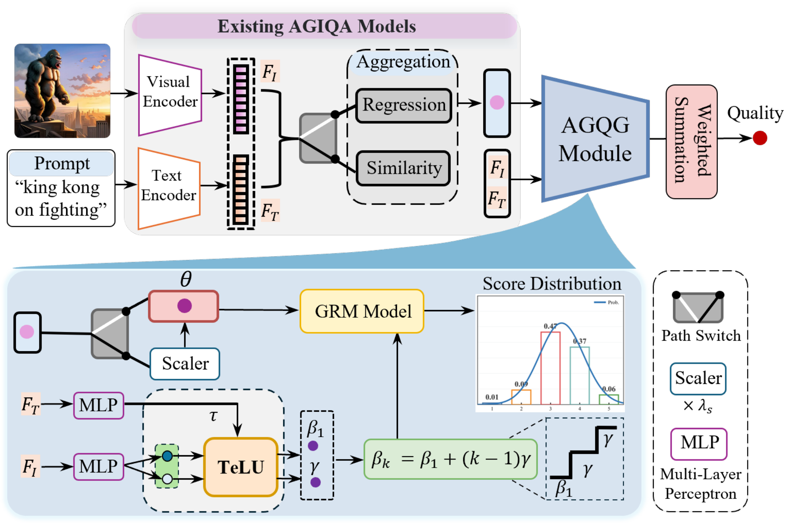
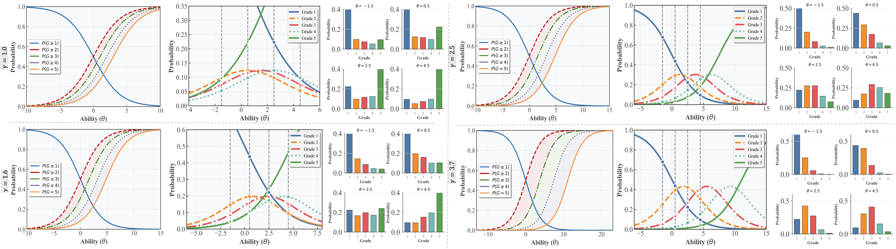
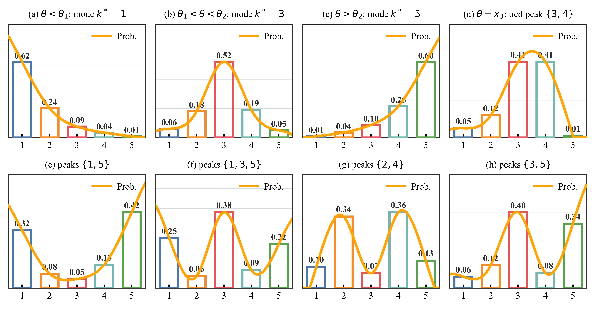
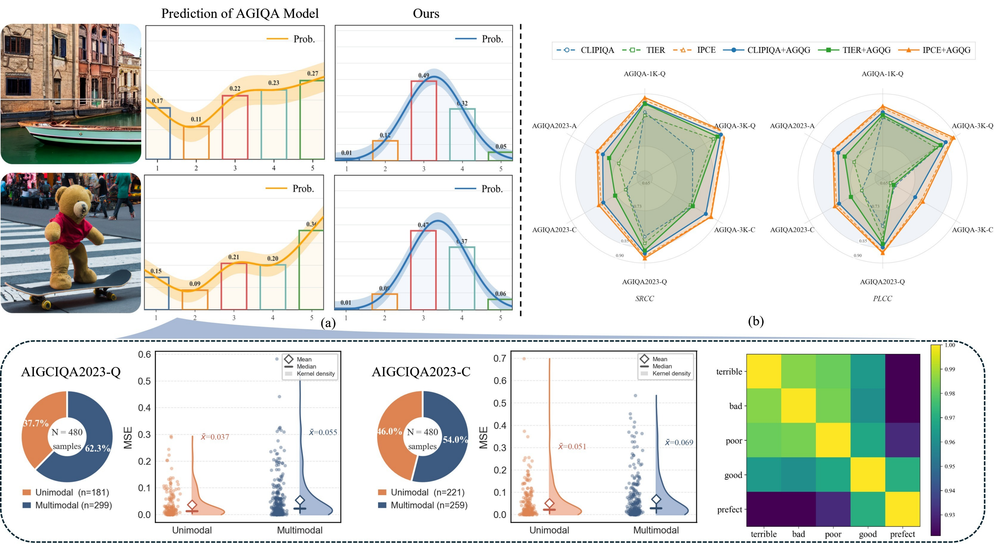
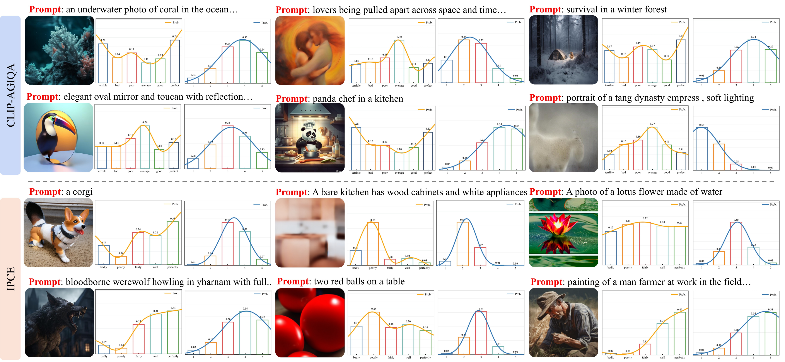
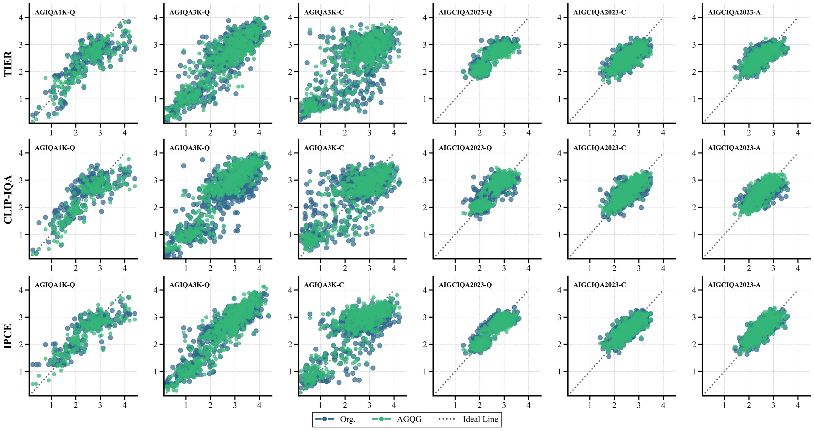
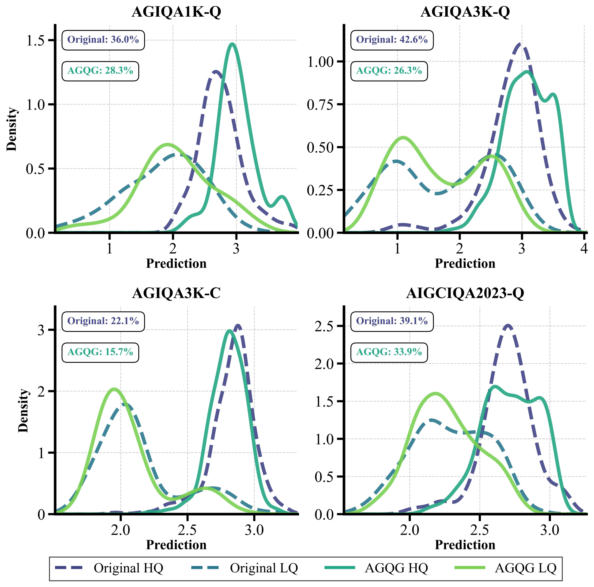
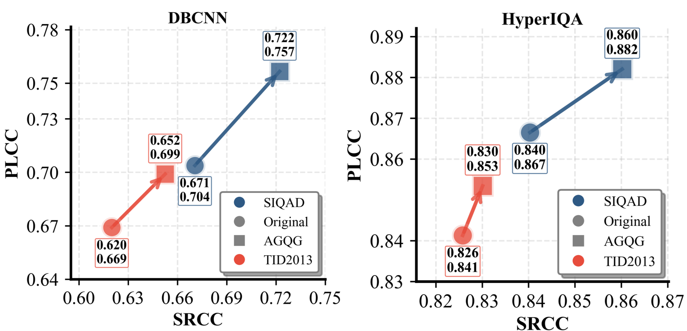
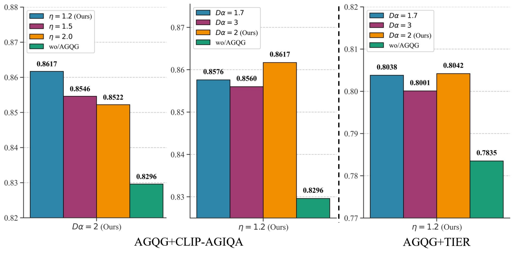

<div align="center">

<h1>Plug In, Grade Right: Psychology-Inspired AGIQA</h1>

<div>
    <a href="https://github.com/zhix000" target="_blank">Zhicheng Liao</a><sup>1</sup>&emsp;
    <a href="" target="_blank">Baoliang Chen</a><sup>1,2,*</sup>&emsp;
    <a href="" target="_blank">Hanwei Zhu</a><sup>2</sup>&emsp;
    <a href="" target="_blank">Lingyu Zhu</a><sup>3</sup>&emsp;
    <a href="" target="_blank">Shiqi Wang</a><sup>3</sup>&emsp;
    <a href="" target="_blank">Weisi Lin</a><sup>2</sup>
</div>
<div>
    <sup>1</sup>South China Normal University, China&emsp; 
    <sup>2</sup>Nanyang Technological University, Singapore&emsp; 
    <sup>3</sup>City University of Hong Kong, China&emsp; 
    <br>
    <sup>*</sup>Corresponding author
</div>

<div>
    <h4 align="center">
        • <a href="https://arxiv.org/pdf/2511.09948" target='_blank'>[arXiv]</a> • 
        <a href="https://agqggithubio.vercel.app/" target='_blank'>[Project Page]</a> •
    </h4>
</div>

<!-- 方案一：左图右文 · 核心亮点布局 -->
<table align="center" style="border: none; border-collapse: collapse; width: 100%; max-width: 1050px; margin: 20px auto;">
  <tr>
    <td width="60%" align="center" valign="middle" style="padding: 10px;">
      
    </td>
    <td width="40%" valign="middle" style="padding: 10px 25px; border-left: 2px solid #d0d7de;">
      <h3 align="left" style="margin-top: 0; color: #24292f;">🌟 Core Highlights</h3>
      <ul align="left" style="line-height: 1.8; color: #24292f; font-size: 15px; padding-left: 20px; margin: 0;">
        <li><b>Psychology-Inspired:</b> First attempt to introduce the Graded Response Model (GRM) into AGIQA.</li>
        <li><b>Unimodal Guarantee:</b> Arithmetic constraints theoretically eliminate "semantic drift" and multi-peak distributions.</li>
        <li><b>Plugable:</b> Seamlessly enhances SOTA models without architectural redesign.</li>
        <li><b>Efficiency Boost:</b> Reduces FLOPs by up to 27% while consistently improving performance.</li>
      </ul>
    </td>
  </tr>
  <tr>
    <td colspan="2" align="center" style="padding-top: 12px;">
      <em style="font-size: 0.90em; color: #57606a;"><b>Overview</b> of our AGQG enhancement framework. The existing AGIQA model is adopted for ability estimation and augmented with an additional branch for difficulty estimation.</em>
    </td>
  </tr>
</table>
<!-- 
<strong>AGQG brings psychometric quality grading to existing AGIQA models through ability estimation, ordered difficulty modeling, and an arithmetic graded response model.</strong> -->

</div>

---

## 📢 Updates

- [x] **`2026.10.22`**: 🎉 Initial repository creation.
- [x] **`2026.10.22`**: 🚀 **Initial Release:** Open-sourced the core AGQG implementations integrated with **IPCE**, **AMF-Net**, and **CLIP-AGIQA**.
- [x] **`Coming Soon`**: 🌐 **Interactive Demo:** Interactive web demos for AGRM visualization.
- [ ] **`Coming Soon`**: 🛠️ **Comprehensive Toolkit:** More evaluation code, pre-trained checkpoints, backbone supports and training pipelines.


## :bookmark_tabs: Overview

Existing AGIQA models usually produce multi-peak prediction distributions, where the image embedding exhibits higher similarity with both ``excellent (score=5) and poor (score=1)`` descriptions than other intermediate quality grades. Quality-grade prediction in these models can produce multimodal category probabilities, a phenomenon we call **semantic drift**. AGQG is a pluggable grading module inspired by psychometrics. It estimates image ability and ordered quality difficulties, then uses an arithmetic graded response model to produce a unimodal quality distribution.


<div align="center" style="max-width: 1050px; margin: 10px auto;">
  
  <!-- 1. 交互引导横幅 (CTA Banner) -->
  <div style="background: linear-gradient(135deg, #eff6ff 0%, #f6f8fa 100%); border: 1px solid #bfdbfe; border-radius: 12px; padding: 20px 24px; margin-bottom: 24px; display: flex; align-items: center; justify-content: space-between; flex-wrap: wrap; gap: 16px; box-shadow: 0 4px 12px rgba(37,99,235,0.05);">
    <div style="text-align: left; flex: 1; min-width: 280px;">
      <h4 style="margin: 0 0 6px 0; color: #1d4ed8; font-size: 1.05em; display: flex; align-items: center; gap: 8px;">
        <span style="font-size: 1.2em;">✨</span> Explore AGRM Interactively
      </h4>
      <p style="margin: 0; color: #475569; font-size: 0.9em; line-height: 1.6;">
        Static curves too dense? Visit our <b>Project Page</b> to use the dynamic simulator. Adjust ability ($\theta$) and difficulty parameters in real-time to observe the guaranteed unimodal property!
      </p>
    </div>
    <a href="https://agqggithubio.vercel.app/" target="_blank" style="display: inline-flex; align-items: center; gap: 8px; background: #2563eb; color: #ffffff; padding: 12px 24px; border-radius: 8px; text-decoration: none; font-weight: 600; font-size: 0.95em; box-shadow: 0 4px 10px rgba(37,99,235,0.3); transition: all 0.2s; white-space: nowrap;">
      🚀 Try Interactive Demo
    </a>
  </div>

  <!-- 2. 长图展示画框 (限制宽度，防止宽屏拉伸模糊) -->
  <div style="background: #ffffff; border: 1px solid #d0d7de; border-radius: 12px; padding: 16px; box-shadow: 0 10px 30px rgba(0,0,0,0.08);">
    <a href="assets/agrm.png" target="_blank">
      
    </a>
  </div>

  <!-- 3. 学术图注 (限制最大宽度，保证阅读体验) -->
  <em style="font-size: 0.88em; color: #57606a; display: block; text-align: center; margin-top: 16px; line-height: 1.7; max-width: 800px; margin-left: auto; margin-right: auto;">
  <b>Figure 3:</b> Distributions of the cumulative category probability P*(θ) (first row), category response probability P(θ) (second row), and the category response probability at four specific θ (third row). With increasing γ, the response distributions exhibit enhanced unimodality, aligning more closely with the expected behavior in human quality assessment.
  </em>
</div>

<!-- 主图保持正常展示 -->
<div align="center" style="max-width: 850px; margin: 20px auto; padding: 20px; background: #f6f8fa; border-radius: 12px; border: 1px solid #d0d7de;">
  <a href="assets/Response_detai.png">
    
  </a>
  <div style="font-size: 0.85em; color: #57606a; text-align: left; margin-top: 16px; line-height: 1.6; padding: 0 10px;">
      <strong>Examples</strong> of the operational unimodality criterion over five quality grades.
      <br>
      • <strong>Top row (Unimodal):</strong> The four cases of Theorem 1: 
        (a) mode at category 1 (θ &lt; θ<sub>1</sub>); 
        (b) interior mode (θ<sub>1</sub> &lt; θ &lt; θ<sub>2</sub>, θ ≠ x<sub>k</sub>); 
        (c) mode at category 5 (θ &gt; θ<sub>2</sub>); 
        (d) a tied adjacent pair at the intersection θ = x<sub>3</sub>, with the single equality P<sub>3</sub> = P<sub>4</sub>.
      <br>
      • <strong>Bottom row (Multimodal):</strong> Each panel contains a strict valley P<sub>i</sub> &gt; P<sub>j</sub> &lt; P<sub>l</sub> with i &lt; j &lt; l: 
        (e) peaks at {1, 5}; 
        (f) peaks at {1, 3, 5}; 
        (g) peaks at {2, 4}; 
        (h) peaks at {3, 5}.
      <br>
  </div>
</div>

<!-- 折叠面板展示第二张图 -->
<details style="max-width: 950px; margin: 10px auto; border: 1px solid #d0d7de; border-radius: 12px; overflow: hidden;">
  <summary style="cursor: pointer; padding: 15px 20px; background: #f6f8fa; font-weight: 600; color: #0969da; list-style: none; display: flex; align-items: center; gap: 8px;">
    <svg width="16" height="16" viewBox="0 0 16 16" fill="#0969da"><path d="M6.22 3.22a.75.75 0 0 1 1.06 0l4.25 4.25a.75.75 0 0 1 0 1.06l-4.25 4.25a.751.751 0 0 1-1.042-.018.751.751 0 0 1-.018-1.042L9.94 8 6.22 4.28a.75.75 0 0 1 0-1.06Z"></path></svg>
    Click to expand: Illustration of the <i>“semantic drift”</i> phenomenon in existing AGIQA models. 
  </summary>
  <div style="padding: 20px; background: #ffffff; text-align: center;">
    <a href="assets/semantic_drift.png">
      
    </a>
    <div style="font-size: 0.9em; color: #57606a; text-align: left; margin-top: 15px; line-height: 1.6;">
      <br><br>
      <b>(a)</b> Comparison of quality grade predictions between IPCE and our enhanced model. 
      <br>
      <b>(b)</b> Our AGQG module consistently improves existing AGIQA models (CLIP-IQA, TIER, IPCE) across six diverse datasets spanning perceptual quality (<i>Q</i>), prompt consistency (<i>C</i>), and perceptual authenticity (<i>A</i>) dimensions. 
      <br><br>
      <span style="color: #0969da; font-weight: 600;">The raincloud plots of MSE distributions reflect that multimodal samples exhibit higher MSE compared to unimodal ones. The similarity matrix of multi-grade quality prompts reveals an ordinal structure: adjacent prompts are more similar, and similarity decreases with distance.</span>
    </div>
  </div>
</details>


## :diamonds: Installation
```bash
git clone https://github.com/zhix000/AGQG.git
cd AGQG

python agqg_ipce.py                   # IPCE + AGQG training  and testing example
python agqg_AMFNet.py                 # AMFF-Net + AGQG 
python agqg_aigciqa.py                # CLIP-AGIQA + AGQG 
```
<!-- | Component | Purpose | Main entry points |
| --- | --- | --- |
| **IPCE + AGQG** | Prompt-image quality grading with the proposed module | `grm_ipce_rebu.py`, `cross_IPCE.py`, `infer_ipce_noise_prompt.py` |
| **AMF-Net + AGQG** | Multi-scale quality, authenticity, and consistency assessment | `grm_AMFNet.py`, `grm_AMFNet_one.py`, `cross_AMFNet.py` |
| **CLIP-AGIQA + AGQG** | CLIP-based multi-grade AGIQA integration | `grm_aigciqa.py` | -->

<!-- The shared model components are kept in `modules/` and `clip_atten/`. The upstream AMF-Net implementation is kept in `AMFF-Net/`. -->

<!-- ## :art: Quality-grade visualization

<div align="center" style="max-width: 950px; margin: 30px auto; padding: 20px; background: #f6f8fa; border-radius: 12px; border: 1px solid #d0d7de;">
  <a href="assets/grade_probabilities.png">
    
  </a>
  <em style="font-size: 0.85em; color: #57606a; display: block; text-align: center; margin-top: 12px;"><b>Figure 6:</b> Quality-grade predictions before and after AGQG integration. Each triplet shows an input image, the original prediction, and the AGQG-enhanced prediction.</em>
</div> -->

## :chart_with_upwards_trend: Representative results
<!-- 主图保持正常展示 -->
<div align="center" style="max-width: 950px; margin: 20px auto; padding: 20px; background: #f6f8fa; border-radius: 12px; border: 1px solid #d0d7de;">
  <a href="assets/grade_probabilities.png">
    
  </a>
  <em style="font-size: 0.85em; color: #57606a; display: block; text-align: center; margin-top: 12px;">
    <b>Quality-grade predictions</b> before and after AGQG integration. Each triplet shows an input image, the original prediction, and the AGQG-enhanced prediction.
  </em>
</div>

<p align="center" style="color: #57606a; font-size: 0.95em;">
  The examples demonstrate that AGQG  mitigates separated probability peaks and produces a unimodal distribution over ordered quality grades.
</p>

<!-- 折叠面板展示第二张图 -->
<details style="max-width: 950px; margin: 10px auto; border: 1px solid #d0d7de; border-radius: 12px; overflow: hidden;">
  <summary style="cursor: pointer; padding: 15px 20px; background: #f6f8fa; font-weight: 600; color: #0969da; list-style: none; display: flex; align-items: center; gap: 8px;">
    <svg width="16" height="16" viewBox="0 0 16 16" fill="#0969da"><path d="M6.22 3.22a.75.75 0 0 1 1.06 0l4.25 4.25a.75.75 0 0 1 0 1.06l-4.25 4.25a.751.751 0 0 1-1.042-.018.751.751 0 0 1-.018-1.042L9.94 8 6.22 4.28a.75.75 0 0 1 0-1.06Z"></path></svg>
    Click to expand: Representative Results (Figure 4: Predicted scores vs. MOS)
  </summary>
  <div style="padding: 20px; background: #ffffff; text-align: center;">
    <a href="assets/score_scatter.png">
      
    </a>
    <em style="font-size: 0.85em; color: #57606a; display: block; text-align: center; margin-top: 12px;">
      <b>Figure 4:</b> Predicted scores versus ground-truth MOS. Blue: original models; green: models with AGQG; dashed line: ideal prediction. Q/C/A denote quality, consistency, and authenticity.
    </em>
  </div>
</details>


<!-- <div align="center" style="max-width: 950px; margin: 30px auto; padding: 20px; background: #f6f8fa; border-radius: 12px; border: 1px solid #d0d7de;">
  <a href="assets/score_scatter.png">
    
  </a>
  <em style="font-size: 0.85em; color: #57606a; display: block; text-align: center; margin-top: 12px;"><b>Figure 4:</b> Predicted scores versus ground-truth MOS. Blue: original models; green: models with AGQG; dashed line: ideal prediction. Q/C/A denote quality, consistency, and authenticity.</em>
</div> -->


<!-- 
The following values are copied from the accompanying paper tables. They are included only to show the intended evaluation protocol; this compact release does not include the datasets or checkpoints needed to reproduce them directly.

| Dataset / dimension | IPCE SRCC | IPCE PLCC | AGQG + IPCE SRCC | AGQG + IPCE PLCC |
| --- | ---: | ---: | ---: | ---: |
| **AGIQA-3K** / Quality | 0.8841 | 0.9246 | **0.8911** | **0.9284** |
| **AGIQA-3K** / Consistency | 0.7697 | 0.8725 | **0.7717** | **0.8741** |
| **AIGCIQA2023** / Quality | 0.8640 | 0.8788 | **0.8671** | **0.8846** |
| **AIGCIQA2023** / Authenticity | 0.8097 | 0.7998 | **0.8115** | **0.8031** | -->

## :mag: Additional Visualizations & Analysis

*Complementary  visualizations showcasing density distributions, generalization on classical frameworks, and hyperparameter sensitivity.*

<!-- 画廊布局：为单列图片添加独立的小卡片样式，保持视觉统一 -->
<table align="center" style="border: none; border-collapse: separate; border-spacing: 15px; width: 100%; max-width: 1050px; margin: 20px auto;">
  <tr>
    <td width="35%" style="padding: 15px; background: #ffffff; border: 1px solid #d0d7de; border-radius: 10px; box-shadow: 0 2px 8px rgba(0,0,0,0.04);">
      
      <em style="font-size: 0.8em; color: #57606a; display: block; text-align: center; margin-top: 8px;"><b>Density distributions</b>  of predicted IQA scores. AGQG reduces the overlap between high- and low-quality distributions.</em>
    </td>
    <td width="50%" style="padding: 15px; background: #ffffff; border: 1px solid #d0d7de; border-radius: 10px; box-shadow: 0 2px 8px rgba(0,0,0,0.04);">
      
      <em style="font-size: 0.8em; color: #57606a; display: block; text-align: center; margin-top: 8px;"><b>Impact</b> of AGQG integration on classical IQA frameworks (DBCNN, HyperIQA) across natural and screen content images.</em>
    </td>
  </tr>
  <tr>
    <td colspan="2" style="padding: 15px; background: #ffffff; border: 1px solid #d0d7de; border-radius: 10px; box-shadow: 0 2px 8px rgba(0,0,0,0.04); text-align: center;">
      
      <em style="font-size: 0.8em; color: #57606a; display: block; text-align: center; margin-top: 8px;"><b>Hyperparameter sensitivity analysis</b>  of AGQG with respect to Dα and η.</em>
    </td>
  </tr>
  
</table>

## :love_you_gesture: Citation
If you find our work useful for your research, please consider citing the paper:
```
@article{liao2025plug,
  title={Plug In, Grade Right: Psychology-Inspired AGIQA},
  author={Liao, Zhicheng and Chen, Baoliang and Zhu, Hanwei and Zhu, Lingyu and Wang, Shiqi and Lin, Weisi},
  journal={arXiv preprint arXiv:2512.22780},
  year={2025}
}
```

### Contact
If you have any questions, please feel free to reach out at `zcliao@m.scnu.edu.cn, blchen@m.scnu.edu.cn`. 